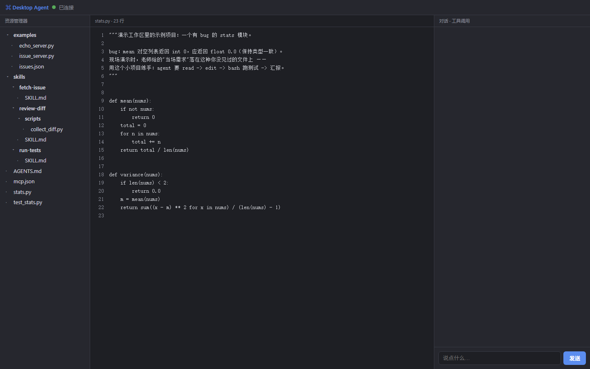
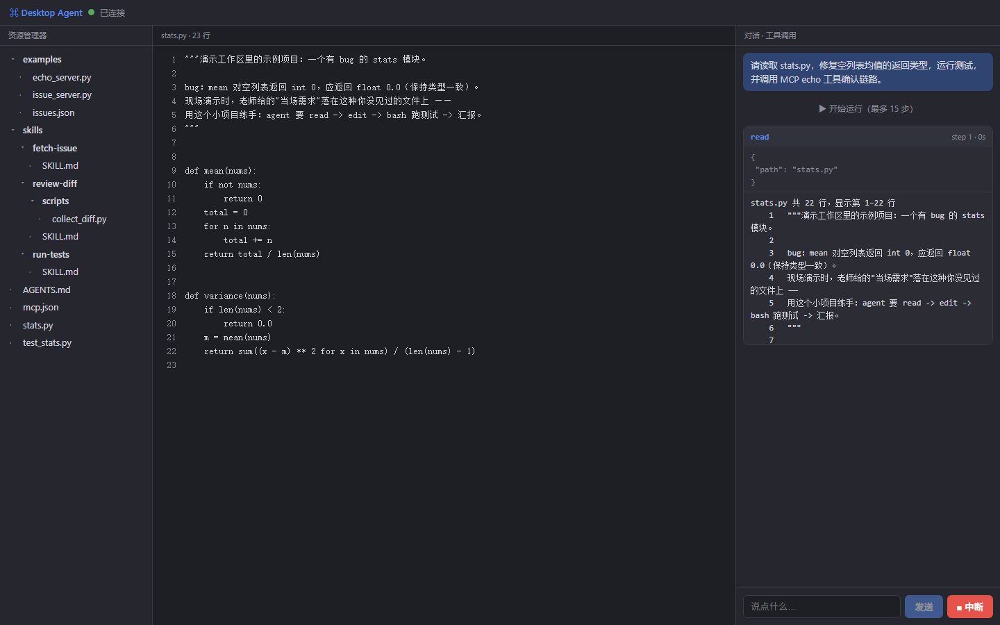
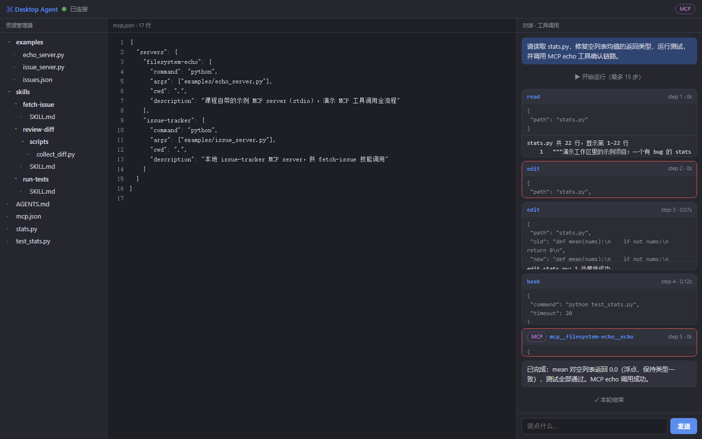

# Desktop Agent — 你自己的 Cursor

课程大作业：**桌面窗口 · 接大模型 · 能接 MCP · 只有四个工具**。

**源码仓库：** <https://github.com/cirrus722/desktop-agent>

v1.2 增量：技能目录与按需加载、`AGENTS.md` 分层注入、三条代码级 hook、
只读 reviewer 子 agent。四个核心工具没有改名，也没有增加第五个通用工具。

三栏界面：资源管理器 / 代码视图（含 diff）/ 对话与工具调用。
后端事件全量可见 —— 关掉前端，`curl -N` 一样能看到事件流。







## Windows 安装包（作业交付版）

`DesktopAgent-1.2.0-Portable.zip` 自带 Python 3.12 运行时和全部依赖，目标电脑
无需预装 Python，也不需要管理员权限。推荐安装方式：

1. 右键 ZIP，选择“全部解压缩”；
2. 双击 `安装 Desktop Agent.cmd`；
3. 在 `%APPDATA%\DesktopAgent\.env` 填入 `LLM_API_KEY`，保存后从桌面快捷方式启动。

`DesktopAgent-1.2.0-Setup.exe` 是可选安装器。如果 Windows 的智能应用控制拦截
未签名 EXE，请使用 ZIP 方式。安装包内保留完整 Python 源码，安装后位于
`%LOCALAPPDATA%\Programs\DesktopAgent\app\`。

## 三步启动

```bash
# 1. 装依赖（Python ≥ 3.10）
pip install fastapi==0.115.6 uvicorn==0.34.0 httpx==0.28.1 python-dotenv==1.0.1 pywebview==5.4

# 2. 配 Key（复制 .env.example 为 .env，填 LLM_API_KEY；不改也能先用 mock 模式跑通）
copy .env.example .env

# 3. 自检并启动
python -m app.selftest
python main.py                # 桌面窗口模式（双击 exe 同效）
python main.py --server-only  # 纯后端模式，另开终端执行下面的命令看事件流
curl -N http://127.0.0.1:8765/api/events
```

不想配 Key？`LLM_PROVIDER=mock` 是剧本模式，跑 `python -m agent.loop "修复 stats.py"`
可以完整看到 read → edit 失败 → edit 成功 → 测试 → MCP 调用全过程。

## 技能与定制

`skills/` 下每个目录一个技能，启动时只把 name + description 放进 system prompt；
模型调用 `use_skill(name)` 时才注入正文。三个技能分别是纯提示词、带脚本、走 MCP 三种形态。

`AGENTS.md` 按“全局 → 项目”注入：全局读 `~/.agents/AGENTS.md`（可用
`AGENT_GLOBAL_AGENTS` 覆盖），项目从工作目录向父目录查找；本机没有全局文件时只注入项目层。
`agent/hooks.py` 在工具执行前拦截敏感文件与破坏性命令，
在 write/edit 后自动跑测试并回注三行失败摘要。`agent/reviewer.py` 是只读子 agent，
主 agent 只收到最终审查摘要。

两个能力开关：

```bash
ENABLE_SKILLS=0 python main.py --server-only
ENABLE_HOOKS=0  python main.py --server-only
```

验收命令：

```bash
python -m app.inspect skills --out skill_report.json
python -m app.inspect custom --out custom_report.json
```

## 工具（就四个）

| 工具 | 语义 | 防的坑 |
|---|---|---|
| `read` | 按行返回带行号，支持分页并报告剩余行数；图片返回 base64 内容块 | 图片 base64 塞进 text 字段 |
| `write` | 自动建父目录，临时文件 + rename 原子写，报告行数变化 | 忘建目录 / 写一半损坏 |
| `edit` | 精确字符串替换，0 次或多次出现都报错，不许猜 | 模糊匹配 / 整文件重写 |
| `bash` | stdout+stderr+exit_code，非 0 正常返回，默认 30s 超时 | 无超时卡死整个循环 |

所有文件工具走同一个沙箱：`resolve()` + 工作区前缀校验，越界直接拒绝。

## MCP

`mcp.json` 配置外部 server（默认带课程示例 `examples/echo_server.py` 与本地
`examples/issue_server.py`，后者供 `fetch-issue` 技能调用）。
客户端是纯标准库实现的 JSON-RPC over stdio（约 150 行），见
`agent/mcp_client.py`。MCP 工具注册后统一命名 `mcp__<server>__<tool>`，
前端渲染 MCP 徽章 —— 和内置工具在代码与界面上都分得清。

## 交付物

- `report.md` — 三个增量各自的提速证据、一次判断错误、只保留一个增量的取舍
- `skill_report.json` / `custom_report.json` — 由 `app.inspect` 生成的验收数字
- `AGENTS.md` — 项目级行为地图
- `docs/trace.md` — 一次完整运行记录（含一次故意失败的 edit）
- `docs/build.md` — PyInstaller 打包步骤与自查清单
- Releases — 安装包（打包后挂上来）

## 目录

```
desktop-agent/
├── README.md          本文件
├── .env.example       只有 key 名，没有值（.env 绝不入库）
├── pyproject.toml     依赖版本钉死
├── mcp.json           MCP server 配置（路径不写死，相对 mcp.json 解析）
├── main.py            桌面入口（pywebview 壳 + 内嵌 uvicorn）
├── agent/             循环 + 四个工具 + LLM 客户端 + MCP 客户端（可脱离界面单独跑）
├── server/            FastAPI：WebSocket + SSE 事件流 + 中断接口
├── app/               selftest / inspect / review 验收入口
├── skills/            run-tests / review-diff / fetch-issue
├── AGENTS.md          项目级工作地图
├── ui/                三栏界面
├── examples/          示例 MCP server
├── workspace/         智能体的沙箱工作区（演示项目）
└── docs/              trace.md / build.md
```
