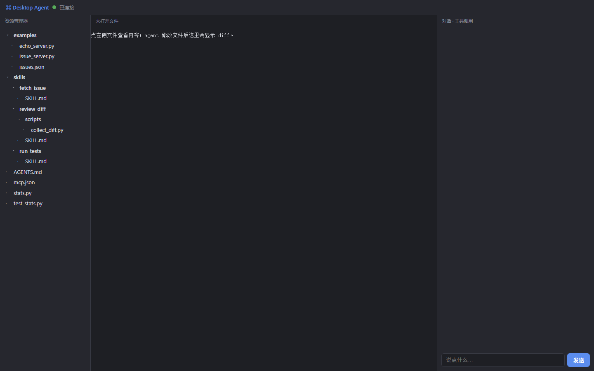

# Desktop Agent 安装与使用说明

**版本：1.2.0　适用系统：Windows 10 / 11 64 位**

Desktop Agent 是一个可安装到 Windows 的桌面智能体。它不是网页截图，也不是只会聊天的窗口：它在桌面窗口中接入大模型，能够读取和修改真实文件、执行命令、调用 MCP 工具，并把每一步工具调用、diff 和测试结果展示出来。



## 1. 软件从哪里来

- 原始工程：课程大作业 `desktop-agent` 的 Python 源码。
- 安装来源：本作业交付的 `DesktopAgent-1.2.0-Portable.zip`（推荐，内含一键安装脚本）或 `DesktopAgent-1.2.0-Setup.exe`。两者都自带 Python 3.12 运行时和全部依赖，目标电脑不需要预装 Python，也不需要管理员权限。
- 源码位置：安装完成后位于安装目录的 `app\`，与开发时使用的源码一致；安装包内也带有源码。
- GitHub 仓库：<https://github.com/cirrus722/desktop-agent>（公开仓库，包含全部源码、构建脚本与文档；安装目录下也有一份 `docs\GITHUB_URL.txt`）。

> 这个安装器是课程作业构建产物，没有商业代码签名证书。Windows SmartScreen 可能提示“未知发布者”，此时点“更多信息 → 仍要运行”。如果电脑开启了“智能应用控制”并强制阻止未签名 EXE，请使用 ZIP 包中的一键安装脚本；脚本使用系统自带命令和已签名的 Python 运行时，不会被拦截。

## 2. 安装步骤

推荐方式（适用于开启了智能应用控制的电脑）：

1. 右键 `DesktopAgent-1.2.0-Portable.zip`，选择“全部解压缩”。
2. 进入解压后的文件夹，双击 `安装 Desktop Agent.cmd`。
3. 安装脚本会把程序复制到当前用户目录，默认路径为 `%LOCALAPPDATA%\Programs\DesktopAgent`。
4. 安装完成后会自动打开 Desktop Agent 窗口，并打开配置文件 `%APPDATA%\DesktopAgent\.env`。

如果 `DesktopAgent-1.2.0-Setup.exe` 能正常运行，也可以直接双击它，效果相同。

5. 在 `.env` 中找到这一行：

```text
LLM_API_KEY=sk-xxx
```

把它换成你自己的 API Key：只替换等号右边的 `sk-xxx`，保留 `LLM_API_KEY=` 不变，不要加引号或空格。

6. 保存并关闭记事本；如果程序已经先打开了，关闭程序后从桌面快捷方式重新启动。

DeepSeek 用户可以在 <https://platform.deepseek.com/api_keys> 创建 Key。默认配置已经是 DeepSeek 的 OpenAI 兼容接口，一般只需要改 `LLM_API_KEY` 一行。

### 安装后在哪里启动

- 桌面快捷方式：`Desktop Agent`
- 开始菜单：`Desktop Agent → Desktop Agent`
- 程序目录：`%LOCALAPPDATA%\Programs\DesktopAgent`
- 启动文件：`启动 Desktop Agent.vbs`（双击不显示黑色控制台窗口）
- 出错排查：`启动 Desktop Agent（调试）.cmd`（显示 Python 错误信息）

### 配置 API Key 的另一种入口

开始菜单中有 `配置 API Key`，也可以直接按 `Win + R`，输入：

```text
notepad %APPDATA%\DesktopAgent\.env
```

不要把带真实 Key 的 `.env` 上传到 GitHub。仓库只保存 `.env.example`。

<!-- pagebreak -->

## 3. 它到底有什么功能

### 3.1 桌面窗口 + 三栏工作台

左侧是工作区文件树，中间是代码/diff，右侧是对话和工具调用。所有智能体事件都从后端事件流推送，不依赖前端伪造。

- 文件树可以点击打开文件；
- 修改文件后中间自动显示 unified diff；
- 对话区逐条显示 `read`、`write`、`edit`、`bash` 和 MCP 工具卡片；
- 工具失败会显示红色错误卡片，模型能看到错误并继续自救；
- 顶部绿点表示 WebSocket 已连接，红点表示后端未连接。

### 3.2 接入大模型

支持两类接口：

- `openai`：OpenAI 兼容接口，默认 `https://api.deepseek.com` + `deepseek-chat`；
- `anthropic`：Anthropic Messages API；
- `mock`：无需 Key 的固定剧本模式，只用于课程演示和联调。

相关配置全部在 `%APPDATA%\DesktopAgent\.env`。

### 3.3 只有四个通用工具

| 工具 | 功能 | 关键防护 |
|---|---|---|
| `read` | 按行读取文件，支持分页和图片 | 行号清晰；图片以内容块返回 |
| `write` | 创建/覆盖文件 | 自动建目录；临时文件 + rename 原子写 |
| `edit` | 精确字符串替换 | 0 次或多次匹配都报错，拒绝模糊修改 |
| `bash` | 执行命令，返回 stdout/stderr/退出码 | 超时；工作区沙箱；中断时杀进程 |

所有文件路径经过 `resolve()` 和工作区前缀校验，`../` 越界会被拒绝。

### 3.4 技能（Skills）按需加载

启动时只把技能名称和描述放进系统提示；模型真正需要时才调用 `use_skill` 读取正文，避免把全部流程塞进上下文。

内置三个技能：

- `run-tests`：先跑测试，红灯定位，改完再跑绿灯；
- `review-diff`：收集 diff 并做只读审查；
- `fetch-issue`：通过本地 issue-tracker MCP server 获取 issue。

<!-- pagebreak -->

### 3.5 AGENTS.md 分层注入

项目级 `AGENTS.md` 会从工作目录向上查找；也支持全局 `~/.agents/AGENTS.md`。模型因此知道项目结构、命令和坑，不需要每次重复解释。

### 3.6 Hooks 护栏与自动测试

- 工具执行前拦截 `.env`、`.pem`、`.key` 等敏感文件写入；
- 拦截明显的破坏性命令，并给出更安全的替代做法；
- `write` / `edit` 后自动寻找并运行测试；
- 失败时只回注三行摘要，避免把整段 pytest 输出塞进模型上下文。

### 3.7 只读 reviewer 子 agent

主 agent 可以调用 reviewer 检查当前 diff。reviewer 使用独立的只读工具箱，不能写文件、不能执行任意命令，只把审查摘要返回主上下文，减少上下文污染。

### 3.8 MCP over stdio

项目自带两个示例 MCP server：

- `filesystem-echo`：演示 echo 工具；
- `issue-tracker`：演示 `fetch_issue` / `list_issues`。

配置位于工作区的 `mcp.json`。工具统一命名为 `mcp__<server>__<tool>`，界面显示紫色 `MCP` 徽章，与内置工具区分。

### 3.9 会话历史、事件流与中断

- 每轮对话写入 `%APPDATA%\DesktopAgent\.session\history.json`，重启后自动恢复；
- WebSocket 用于页面双向通信，SSE 用于外部观察：`http://127.0.0.1:8765/api/events`；
- “中断”会真实停止循环并终止正在运行的 bash 子进程，不是只改按钮文字。

<!-- pagebreak -->

## 4. 第一次使用怎么验证

### 4.1 看连接状态

启动后等待 2–5 秒，顶部应出现绿点和“已连接”。如果一直是红点，先看 `启动 Desktop Agent（调试）.cmd` 是否报错。

### 4.2 让 agent 做一次真实修改

点击右侧输入框，输入：

```text
请先读取 stats.py，定位空列表均值返回类型的问题，修复后运行 test_stats.py，最后调用 MCP echo 工具确认链路。
```

一次成功运行会依次出现：

1. `read` 工具卡片，读取 `stats.py`；
2. `edit` 工具卡片；若替换字符串不唯一，会先出现一次红色失败卡片；
3. 唯一匹配后成功 edit，中间栏显示 diff；
4. `bash` 运行测试，输出通过；
5. `mcp__filesystem-echo__echo`，右上角出现紫色 MCP 徽章；
6. 最终中文总结和“本轮结束”。

### 4.3 不需要 Key 的演示

如果暂时没有 Key，把 `.env` 改成：

```text
LLM_PROVIDER=mock
```

mock 模式会按固定剧本执行 read → 失败 edit → 成功 edit → 测试 → MCP echo，适合课堂演示，但不会真正理解新问题。

<!-- pagebreak -->

## 5. 安装后的目录

```text
%LOCALAPPDATA%\Programs\DesktopAgent\
├── app\                    完整 Python 源码
│   ├── agent\             循环、工具、LLM、MCP、skills、hooks、reviewer
│   ├── server\            FastAPI + WebSocket + SSE
│   ├── ui\                HTML/CSS/JavaScript 三栏界面
│   ├── skills\            三个技能
│   └── examples\          两个示例 MCP server
├── runtime\python\        自带 Python 3.12 + 全部依赖
├── docs\                  本说明与截图
├── 启动 Desktop Agent.vbs
├── 启动 Desktop Agent（调试）.cmd
├── Uninstall.cmd
└── .env.example（也保留在 app\ 下）

%APPDATA%\DesktopAgent\
├── .env                    你的 API Key 和模型配置
└── .session\history.json   对话历史

%USERPROFILE%\Documents\DesktopAgent\workspace\
├── stats.py               演示项目
├── test_stats.py
├── skills\                工作区技能副本
├── examples\              工作区 MCP server 副本
├── mcp.json
└── AGENTS.md
```

用户代码在“文档 / DesktopAgent / workspace”中，卸载程序不会删除它。

## 6. 常见问题

### 6.1 顶部红点一直不变绿

先确认只启动了一个 Desktop Agent。默认端口是 `8765`；如果旧进程仍占用端口，新进程的后端会启动失败。任务管理器结束旧的 `pythonw.exe`，或在命令提示符执行：

```bat
taskkill /f /im pythonw.exe
```

注意：这会结束当前用户下所有 pythonw 进程，执行前确认没有别的 Python 桌面程序在运行。

### 6.2 提示 401、402 或模型调用失败

- 检查 `LLM_API_KEY` 是否完整、有没有多余空格；
- 检查 Key 是否有余额；
- 检查 `LLM_BASE_URL` 和 `LLM_MODEL` 是否匹配；
- 保存 `.env` 后必须重启程序。

### 6.3 窗口空白或提示 WebView2 缺失

安装 Microsoft Edge WebView2 Runtime（Evergreen）：

<https://developer.microsoft.com/microsoft-edge/webview2/>

Windows 11 和大多数已安装 Edge 的 Windows 10 已经自带 WebView2。

### 6.4 Windows 提示未知发布者

这是课程构建产物，未购买代码签名证书。点击“更多信息 → 仍要运行”。如果系统策略直接阻止，请使用便携版 ZIP。

### 6.5 改了代码但界面没变

前端静态文件在 `app\ui`。修改 `app.js` 或 `style.css` 后，把 `app\ui\index.html` 里的 `?v=5` 改成新版本号，或清理 WebView2 缓存后重启。

### 6.6 如何卸载

打开开始菜单 → `Desktop Agent` → `卸载 Desktop Agent`，或在 Windows“设置 → 应用 → 已安装的应用”中卸载。程序目录会被删除；`%APPDATA%\DesktopAgent` 和文档工作区会保留，便于保留 Key 与代码。

如需彻底清理，在确认备份后手动删除：

```text
%APPDATA%\DesktopAgent
%USERPROFILE%\Documents\DesktopAgent
```

<!-- pagebreak -->

## 7. 作业交付对应关系

| 作业要求 | 对应文件 |
|---|---|
| 1. 安装包（里面有代码） | `DesktopAgent-1.2.0-Portable.zip`（推荐）/ `DesktopAgent-1.2.0-Setup.exe`，安装后代码在 `app\` |
| 2. 说明：来源、功能、GitHub | `安装与使用说明.pdf` / `.md`，GitHub 地址见第 1 节 |
| 3. 演示视频 | `DesktopAgent-演示视频.mp4` |

## 8. 演示视频内容

实际录制文件为 `DesktopAgent-演示视频.mp4`，约 95 秒，带中文字幕。视频依次展示：

1. 软件定位与能力概览；
2. ZIP 解压、运行安装脚本、配置 API Key 的三个步骤；
3. 三栏界面和后端 ReAct 事件流；
4. 打开真实工作区中的 `stats.py`；
5. 输入任务后依次执行 read → 失败 edit → 成功 edit；
6. 中间栏 unified diff、`bash` 测试通过、MCP echo 调用；
7. 最终回答只出现一次；
8. `mcp.json` 与 Skills 按需加载；
9. 交付内容与启动位置。

## 9. 已知限制

- 安装器未做商业代码签名，首次运行可能触发 SmartScreen；
- 默认单实例端口为 `8765`，同一用户同时启动两个实例时，第二个实例会连接失败；
- 模型能力依赖外部 API，需要网络、有效 Key 和余额；
- mock 模式只按固定剧本演示，不代表模型真实推理；
- 自动测试 Hook 只覆盖能自动发现的 `test_*.py` 或 `tests/`，复杂项目建议显式设置 `AGENT_TEST_CMD`。

---

**仓库地址：** <https://github.com/cirrus722/desktop-agent>

**构建时间：** 2026-11-07　**版本：** 1.2.0
